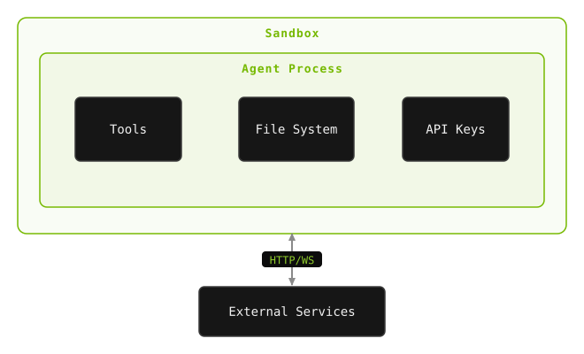
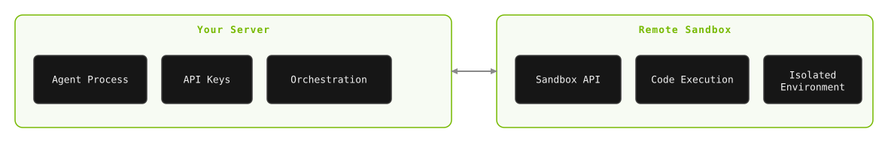

<div class="dx-hero" data-eyebrow="MODULE 05 / 05 - SECURITY" data-title="Sandboxing and Security" data-meta="READ::20 min|DEMOS::2|TAKEAWAY::defense in depth"></div>


Your deep agent can read files, write code, and execute shell commands. That's incredibly powerful — and incredibly dangerous. In this section, we'll see exactly *why* sandboxing matters, explore different approaches, and understand the security principles for evaluating an agent's execution boundary.

<!-- fold:break -->

## Security Matters for Deep Agents

Three characteristics of deep agents amplify security concerns compared to the shallow agents you built in earlier modules:

1. **Extended autonomy** — Longer tasks can involve many actions between human reviews. Planning and delegation can increase that scope; runtime alone does not define a deep agent.

2. **Code execution** — Deep agents run shell commands, write files, install packages, and spawn sub-processes. A hallucinated `rm -rf /` or a fabricated `pip install malicious-package` isn't a hypothetical — it's a well-documented risk.

3. **Cascading effects** — In a multi-agent system, a single sub-agent error can propagate through the entire hierarchy. A researcher sub-agent that follows a malicious link could compromise the orchestrator's entire workspace.

The key insight: subprocesses inherit the permissions of their execution environment. Prompts can guide behavior, but containment requires enforced permissions such as filesystem, process and network restrictions.

<div class="dx-island dx-reveal">
  <p class="dx-island-title">WHAT CAN GO WRONG</p>
  <p>These are not hypotheticals - each is a documented failure mode for autonomous agents:</p>
  <p><span class="dx-chip">DESTRUCTIVE COMMANDS</span> The agent generates and runs rm -rf /important/data while trying to clean up.</p>
  <p><span class="dx-chip">SUPPLY CHAIN</span> It fabricates a package name that happens to match a malicious package on a public registry.</p>
  <p><span class="dx-chip">DATA EXFILTRATION</span> A compromised sub-agent leaks data via DNS tunneling or encoded HTTP requests.</p>
  <p><span class="dx-chip">RESOURCE EXHAUSTION</span> An agent stuck in a retry loop spawns thousands of sub-processes.</p>
</div>

<!-- fold:break -->

### The Problem: Host Shell Access

With Shell Execution enabled and sandboxing off, commands run with the backend user's host access. File I/O alone is confined to its configured file-tool root.

#### Demo: No Sandbox

In the Deep Agent Builder UI, make sure **Sandbox Mode is OFF** (you'll see "⚠️ No Sandbox" in the header). Build an agent with Shell Execution and File I/O and ask:

> *"What files are in my workspace?"*

The agent will respond with something like:

<div class="dx-term dx-reveal">
  <span class="dx-term-title">no sandbox - agent runs on the host</span>
  <span class="dx-term-line" data-kind="prompt">What files are in my workspace?</span>
  <span class="dx-term-line" data-kind="tool" data-delay="300">ls /tmp/deepagent_workspace</span>
  <span class="dx-term-line" data-kind="answer" data-delay="350">passwords.txt    ssn_records.txt</span>
</div>

<!-- fold:break -->

Now ask it to read one:

> *"Read the contents of passwords.txt"*

The provided fictional fixture can produce:

<div class="dx-term dx-reveal">
  <span class="dx-term-title">no sandbox - reading a host file</span>
  <span class="dx-term-line" data-kind="prompt">Read the contents of passwords.txt</span>
  <span class="dx-term-line" data-kind="tool" data-delay="300">read_file(/tmp/deepagent_workspace/passwords.txt)</span>
  <span class="dx-term-line" data-kind="answer" data-delay="350">admin:SuperSecret123!</span>
  <span class="dx-term-line" data-kind="answer" data-delay="120">root:P@ssw0rd_2026</span>
  <span class="dx-term-line" data-kind="answer" data-delay="120">db_user:mysql_prod_xK9#mN2</span>
</div>

Shell commands can read host files that the backend user can access. Network access can also provide a route to send that data elsewhere.

<!-- fold:break -->

### The Solution: Sandboxing

**Sandboxing** isolates the agent's execution environment from the host system. The boundary depends on mounts, networking and credentials. This demo puts file and shell tools in a nonroot container with no host mounts, no network, and no inherited vendor keys; the model and Web/RAG tools remain in the application.

#### Demo: With Sandbox

Click "Build a New Agent". Now recreate your deep agent and toggle **Sandbox Mode ON** in the Settings panel (you'll see "🔒 Sandboxed" in the header). 

Build a new agent and ask the same question:

> *"What files are in my workspace?"*

The agent responds:

<div class="dx-term dx-reveal">
  <span class="dx-term-title">sandboxed - fresh container, no host mounts</span>
  <span class="dx-term-line" data-kind="prompt">What files are in my workspace?</span>
  <span class="dx-term-line" data-kind="tool" data-delay="300">ls /workspace</span>
  <span class="dx-term-line" data-kind="answer" data-delay="350">The workspace at /workspace is empty - no files present. The host filesystem is not visible from inside the container.</span>
</div>

**The sensitive files don't exist inside the sandbox.** The agent runs in a fresh Docker container with no host mounts. Host files are not mounted into it; containers still share the host kernel.

<!-- fold:break -->

## The Security Spectrum

Not all isolation is equal. Approaches range from trusting the model entirely to full hardware virtualization. Understanding this spectrum helps you choose the right level for your use case.

<div class="dx-island dx-reveal">
  <p class="dx-island-title">COMMON EXECUTION BOUNDARIES — NOT A SECURITY SCORE</p>
  <div class="dx-tax">
    <div class="dx-tax-row" style="--dx-w:8"><span class="dx-tax-name">Prompt-only</span><div class="dx-tax-track"><div class="dx-tax-fill">none</div></div><span class="dx-tax-note">dev/testing only</span></div>
    <div class="dx-tax-row" style="--dx-w:28"><span class="dx-tax-name">Deno runtime</span><div class="dx-tax-track"><div class="dx-tax-fill">grants</div></div><span class="dx-tax-note">lightweight scripting</span></div>
    <div class="dx-tax-row" style="--dx-w:48"><span class="dx-tax-name">Bubblewrap / Seatbelt</span><div class="dx-tax-track"><div class="dx-tax-fill">FS + net</div></div><span class="dx-tax-note">desktop agents (Claude Code)</span></div>
    <div class="dx-tax-row" style="--dx-w:68"><span class="dx-tax-name">Docker + seccomp</span><div class="dx-tax-track"><div class="dx-tax-fill">process</div></div><span class="dx-tax-note">most production</span></div>
    <div class="dx-tax-row" style="--dx-w:85"><span class="dx-tax-name">gVisor</span><div class="dx-tax-track"><div class="dx-tax-fill">syscall</div></div><span class="dx-tax-note">high-security</span></div>
    <div class="dx-tax-row" data-tier="max" style="--dx-w:100"><span class="dx-tax-name">Firecracker VM</span><div class="dx-tax-track"><div class="dx-tax-fill">full VM</div></div><span class="dx-tax-note">maximum isolation</span></div>
  </div>
</div>

> Our demo uses Docker containers for agent execution sandboxing and isolation.

<!-- fold:break -->

### Choosing an Isolation Level

These approaches enforce different boundaries; configuration matters within every category. Choose based on your **threat model**: who controls inputs, what data is accessible, and what a breach would affect.

Ask these questions:

1. **Who controls the agent's inputs?** If only trusted developers, you can use lighter isolation. If end users can influence prompts, you need stronger boundaries.
2. **What data can the agent access?** PII, credentials, or financial data demands stronger isolation than public information.
3. **Does the agent execute code?** Choose an enforced execution boundary appropriate to the code and data it can reach.
4. **What are the consequences of a breach?** A leaked API key is bad. A deleted production database is catastrophic. Match isolation to impact.

<!-- fold:break -->

## Patterns for Agent Sandboxing

Before choosing a sandbox technology, you need to choose a sandbox pattern. This architectural decision affects security, latency, and how quickly you can iterate.

### Pattern 1 — Agent IN Sandbox

The agent itself runs inside the sandbox. It communicates with external systems — the LLM API, databases, user interfaces — over HTTP or WebSocket connections.



**Pros:** Mirrors local development; simple architecture — everything runs in one place.

**Cons:** API keys live inside the sandbox unless a gateway outside it supplies them; container rebuilds needed for every agent update; all tools inherit the sandbox's full permissions.

**Best for:** Agents that need a full environment of their own. Module 6 uses this pattern: the whole agent runs inside an OpenShell sandbox, and a gateway keeps the API keys outside it.

<!-- fold:break -->

### Pattern 2 — Sandbox as Tool

The agent runs locally (or on your server), and code execution is delegated to remote sandboxes via API calls. The sandbox is just another tool the agent can call.



**Pros:** API keys stay outside the sandbox; instant agent updates without container rebuilds; clean separation of agent state and execution; enables parallel sandbox execution; sandbox failures don't crash the agent.

**Cons:** Network latency per execution call; more moving parts to manage.

**Best for:** Most production deployments. This is the pattern used by the deepagents library.

| Dimension | Agent IN Sandbox | Sandbox as Tool |
|-----------|-----------------|-----------------|
| Credential security | Keys inside, unless a gateway supplies them | Keys stay external |
| Update speed | Requires rebuild | Instant |
| Failure isolation | Agent + sandbox coupled | Independent |
| Parallel execution | Complex | Natural |

> Our demo uses Pattern 2 — the agent runs on the system and delegates execution to a Docker container.

<!-- fold:break -->

### How Our Sandbox Works

Our implementation uses Docker containers as the isolation boundary — the agent runs on the system and delegates code execution to an isolated container.

```python
class DockerSandboxBackend(SandboxBackendProtocol):
    def __init__(self):
        self._container = docker_client.containers.run(
            "python:3.11-slim",
            command="sleep infinity",
            detach=True,
            working_dir="/workspace",
            mem_limit="512m",
            nano_cpus=1_000_000_000,  # 1 CPU
            # No host mounts — fully isolated
        )
```

Key properties:
- **No host mounts** — The container has its own filesystem
- **Resource limits** — 512MB RAM, 1 CPU
- **Auto-cleanup** — Container is destroyed when the session ends
- **Full protocol compliance** — Implements `SandboxBackendProtocol` so all deepagents tools work transparently

When the agent calls `ls`, `read_file`, `write_file`, or `execute`, those operations happen *inside the container*, not on your machine.

<!-- fold:break -->

## Agent Security Principles

A sandbox is one layer, and any single layer can fail. Stacking controls so that another one catches the failure is called **defense in depth**; Module 6 builds those layers. Three principles from this module carry over:

- **Trust the sandbox, not the model.** The model will sometimes hallucinate a dangerous action, and the agent can do anything its tools allow. Enforce limits at the tool and sandbox level.
- **Least privilege.** Give the agent only the tools it needs. If it doesn't need shell access, don't enable it.
- **Credential isolation.** Keep API keys, passwords, and tokens out of the agent's reach. Don't mount credential files into the sandbox.

<div class="dx-island dx-quiz dx-reveal">
  <p class="dx-island-title">CHECK YOUR UNDERSTANDING</p>
  <p class="dx-quiz-q">Even a well-prompted agent may one day run a dangerous shell command, from a hallucination or an instruction hidden in a file it reads. Which control still protects your machine when that happens?</p>
  <button class="dx-quiz-opt" data-fb="The model can hallucinate right past any instruction, and a subprocess bypasses prompt rules entirely. Application-level controls are necessary but never sufficient.">Add a rule to the system prompt telling it never to run destructive commands</button>
  <button class="dx-quiz-opt" data-fb="Lowering temperature reduces randomness but not capability - one bad command is still catastrophic. Enforce limits at the infrastructure level.">Lower the model temperature so it behaves more predictably</button>
  <button class="dx-quiz-opt" data-right data-fb="Right. Once an agent passes control to a subprocess, OS-level controls bound subprocess access. With no host mounts, the container cannot directly modify the host workspace; its own writable files can still be damaged.">Run it in a sandbox with no host mounts and resource limits</button>
  <button class="dx-quiz-opt" data-fb="A bigger model is still a model - it will still occasionally hallucinate. Safety comes from the boundary around the agent, not the agent's own judgment.">Switch to a larger, more capable model</button>
</div>

<!-- fold:break -->

## Module Wrap-Up

You now have the complete toolkit — from building your first agent to deploying autonomous deep agents safely and securely.

### What You Learned

<div class="dx-bento dx-reveal">
  <div class="dx-cell"><h4>WHAT DEEP AGENTS ARE</h4>Same LLM loop plus planning, delegation, memory, and skills.</div>
  <div class="dx-cell"><h4>SHALLOW VS DEEP</h4>Shallow for focused tasks; deep for complex, long-horizon work.</div>
  <div class="dx-cell"><h4>REAL-WORLD USE</h4>Deep research, coding agents, analysis pipelines.</div>
  <div class="dx-cell"><h4>SECURITY</h4>OS-level isolation is essential for deep agent safety.</div>
</div>

<!-- fold:break -->

### The Full Workshop Arc

<div class="dx-bento dx-reveal">
  <div class="dx-cell"><h4>MODULE 1</h4><span class="dx-big">ReAct</span>Agent fundamentals - tool selection.</div>
  <div class="dx-cell"><h4>MODULE 2</h4><span class="dx-big">RAG + tools</span>Agent capabilities - data security and access.</div>
  <div class="dx-cell"><h4>MODULE 3</h4><span class="dx-big">Evaluation</span>Agent quality - adversarial test cases.</div>
  <div class="dx-cell"><h4>MODULE 4</h4><span class="dx-big">Customization</span>Agent expertise - human-in-the-loop.</div>
  <div class="dx-cell is-wide"><h4>MODULE 5 - YOU ARE HERE</h4><span class="dx-big">Deep agents</span>Agent autonomy - OS-level sandboxing.</div>
</div>

Each level of capability demands a corresponding level of security. Deep agents sit at the far end of this spectrum — the most capable and the most in need of containment.

> **Congratulations!** You've completed Module 5: Deep Agents.

> Next: **Module 6: Agent Safety**. This module sandboxed the agent's commands. Module 6 puts the whole agent inside a sandbox and enforces policy from outside it.
